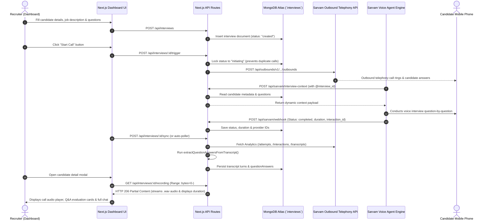

# Sarvam AI Voice Interview Platform — Complete System Architecture & Project Documentation

> **Purpose of this document**: This is an exhaustive, self-contained technical specification and architectural breakdown of the **Sarvam AI Voice Interview Platform**. It is designed to provide developers, architects, and AI models with a complete, end-to-end understanding of how the codebase is organized, how the telephony voice agents integrate with the backend, how audio and transcripts are processed, and how the database and frontend are structured.

---

## 1. Executive Summary

The **Sarvam AI Voice Interview Platform** is a full-stack Next.js (App Router) enterprise candidate screening application. It enables recruiters to define structured interview questions for specific job profiles, initiate outbound conversational AI phone calls to candidates' mobile phones via **Sarvam AI Telephony Agents**, dynamically feed context to the AI agent at call initialization, ingest live call transcripts and audio recordings, and automatically parse candidate answers into structured evaluations.

### Core Capabilities
- **Automated Outbound Voice Calling**: Directly triggers phone calls using Sarvam's Outbound Telephony API through connected telecom providers (Exotel, Twilio, Pulse, etc.).
- **Dynamic Context Injection**: Implements an `on_start` HTTP tool endpoint (`/api/sarvam/interview-context`) queried by the Sarvam AI voice agent as soon as the call picks up to inject candidate details, job description, and custom questions.
- **Intelligent Q&A Answer Extraction**: Automatically parses natural conversation transcripts into structured question-and-answer pairs matching each interview question.
- **Low-Latency RFC 7233 Audio Streaming**: Built-in HTTP 206 Partial Content range-streaming audio proxy with in-memory caching to play and scrub high-quality raw WAV call recordings directly in the browser.
- **Dual-Tier Security**: Supports both secure HTTP-only JWT admin session cookies for web dashboard users and Bearer `INTERNAL_API_KEY` for programmatic integrations and automation pipelines.
- **Persistent MongoDB Connection Pooling**: Production-grade native MongoDB driver singleton that avoids connection exhaustion across serverless and hot-reload cycles.
- **Dark Charcoal Recruiter Dashboard**: Modern responsive UI with live status metrics, call progress monitors, collapsible Q&A evaluation cards, and turn-by-turn dialogue bubbles.

---

## 2. Technology Stack & Dependencies

| Layer | Technologies / Libraries | Purpose |
| :--- | :--- | :--- |
| **Framework** | Next.js 16 (App Router), React 19, TypeScript | Serverless route handlers, server-side logic, and interactive UI |
| **Styling & Icons** | Tailwind CSS 3.4, Lucide React (`lucide-react`) | Responsive charcoal dark theme (`#090d16`), status badges, dynamic icons |
| **Database** | MongoDB Native Driver (`mongodb` v7.5) | Persistent connection pool, unstructured JSON storage for calls, transcripts & metadata |
| **Authentication** | `jose` (v6.2) | Lightweight edge-compatible JWT signing and verification |
| **Validation** | Zod (`zod` v4.4) | Strict runtime schema validation for API inputs, webhook payloads, and environment variables |
| **Voice / Telephony** | Sarvam AI Platform (`apps.sarvam.ai`) | Outbound calling engine, speech-to-text, text-to-speech, conversational AI agent |
| **Runtime / Tooling** | Node.js (v20+ / v22), PostCSS, Autoprefixer | Package execution and asset compilation |

---

## 3. End-to-End System Architecture



---

## 4. Complete Project Directory Structure

```text
sarvam-ai-calling-agent/
├── app/                                  # Next.js App Router root
│   ├── api/                              # REST API Route Handlers
│   │   ├── auth/                         # Admin Authentication
│   │   │   ├── login/route.ts            # POST: Authenticates admin, sets HTTP-only JWT cookie
│   │   │   ├── logout/route.ts           # POST: Clears session cookie
│   │   │   └── session/route.ts          # GET: Validates current session token
│   │   ├── health/                       # System Diagnostics
│   │   │   └── route.ts                  # GET: Health check, MongoDB connection & config status
│   │   ├── interviews/                   # Interview Management
│   │   │   ├── route.ts                  # GET (list/filter/paginate) & POST (create candidate/interview)
│   │   │   └── [id]/                     # Single Interview Operations
│   │   │       ├── route.ts              # GET: Fetch full single interview document
│   │   │       ├── recording/route.ts    # GET: RFC 7233 Range-streaming proxy for .wav call audio
│   │   │       ├── sync/route.ts         # POST: Force pull latest analytics, transcripts & duration from Sarvam
│   │   │       └── trigger/route.ts      # POST: Initiate outbound phone call to candidate
│   │   └── sarvam/                       # Sarvam AI Webhook & Tool Handlers
│   │       ├── interview-context/        # POST/GET: On-start hook supplying questions to Voice Agent
│   │       │   └── route.ts
│   │       ├── interview-result/         # POST/GET: Endpoint for receiving agent outputs & evaluation
│   │       │   └── route.ts
│   │       ├── result/route.ts           # POST/GET: Alias handler for interview-result
│   │       └── webhook/route.ts          # POST: Telephony lifecycle webhook (ringing, answered, completed)
│   ├── dashboard/                        # Web Recruiter Dashboard
│   │   └── page.tsx                      # Client dashboard with polling, summary cards & tables
│   ├── login/                            # Admin Login View
│   │   └── page.tsx                      # Login card with credentials validation
│   ├── globals.css                       # Design system tokens, color palettes & Tailwind directives
│   └── layout.tsx                        # Root layout wrapping Toast notification provider
│
├── components/                           # Modular UI Components
│   ├── auth/
│   │   └── LoginForm.tsx                 # Admin login form with loading states & error handling
│   ├── dashboard/
│   │   ├── Header.tsx                    # Top navigation header with telephony status badge & logout
│   │   └── SummaryCards.tsx              # Telephony metrics (Total, Completed, In-Progress, Failed, Busy)
│   ├── interviews/
│   │   ├── CreateInterviewForm.tsx       # Dynamic form for candidate info, job description & questions
│   │   ├── InterviewDetailModal.tsx      # Modal with audio player, Q&A answers & transcript bubbles
│   │   ├── InterviewTable.tsx            # Data table with search, status filters & action buttons
│   │   └── StartCallModal.tsx            # Safety confirmation modal before dialing outbound calls
│   └── ui/                               # Reusable Atomic UI Elements
│       ├── Badge.tsx                     # Color-coded status pills (Completed, Ringing, Failed, etc.)
│       ├── Button.tsx                    # Accessible button with variants, icons & spinner states
│       ├── Card.tsx                      # Charcoal container card with borders and headers
│       ├── Input.tsx                     # Form text inputs and textareas
│       ├── Modal.tsx                     # Accessible backdrop modal with keyboard escape handling
│       └── Toast.tsx                     # Context-based toast notification alerts
│
├── lib/                                  # Core Business Logic & Infrastructure
│   ├── auth/
│   │   └── session.ts                    # JWT creation, cookie verification, and cookie clearing
│   ├── sarvam/
│   │   ├── client.ts                     # SarvamClient class: outbound trigger, analytics queries, audio lookup
│   │   ├── mapper.ts                     # Status code normalizer, transcript parser & ID sanitizers
│   │   └── security.ts                   # HMAC SHA-256 and secret header validation for webhooks
│   ├── security/
│   │   ├── api-guard.ts                  # Route protector: accepts browser session OR Bearer INTERNAL_API_KEY
│   │   ├── headers.ts                    # Strict Content Security Policy (CSP) & security headers
│   │   └── rate-limit.ts                 # IP-based sliding window rate limiter
│   ├── storage/
│   │   ├── index.ts                      # Repository factory: switches between Mongo & Memory repository
│   │   ├── interface.ts                  # Abstract TypeScript interface for interview repositories
│   │   ├── memory-repository.ts          # In-memory repository fallback for offline/development use
│   │   ├── mongo-repository.ts           # Production MongoDB implementation with auto QA extraction
│   │   └── mongodb.ts                    # Singleton MongoClient connection pool manager
│   ├── utils/
│   │   ├── env.ts                        # Helper ensuring .env variables are loaded
│   │   ├── logger.ts                     # Structured JSON logger
│   │   ├── phone.ts                      # E.164 phone number parser and Indian regional standardizer
│   │   ├── qa-extractor.ts               # Chronological transcript parser mapping candidate responses to questions
│   │   └── response.ts                   # Standardized JSON response formatters (`successResponse`, `errorResponse`)
│   └── validation/
│       ├── auth.ts                       # Zod schemas for login credentials
│       ├── interview.ts                  # Zod schemas for candidate creation, questions, and query filters
│       └── sarvam.ts                     # Zod schemas for Sarvam webhooks and context requests
│
├── types/                                # TypeScript Data Models
│   ├── api.ts                            # API envelope types (`ApiResponse<T>`, `ApiError`)
│   ├── interview.ts                      # `Interview`, `Candidate`, `Job`, `Question`, `QuestionAnswer`, `CallInfo`
│   └── sarvam.ts                         # Sarvam API payloads, webhook schemas, and connection configs
│
├── .env.example                          # Canonical environment variable template
├── .env.local                            # Local active environment variables (credentials)
├── Dockerfile                            # Production multi-stage Docker build container
├── cloudbuild.yaml                       # Google Cloud Build deployment pipeline
├── middleware.ts                         # Next.js route protection & dashboard redirect middleware
├── next.config.ts                        # Next.js build and runtime configuration
├── package.json                          # Dependencies and npm script targets
├── tsconfig.json                         # TypeScript compiler configuration with `@/*` aliases
└── README.md                             # Quickstart and overview readme
```

---

## 5. The Seven Key Subsystems Detailed

### 1. Database & Persistence Layer (`lib/storage/`)
- **Singleton Connection Pool ([mongodb.ts](file:///Users/sailok/Code/sarvam-ai-calling-agent/lib/storage/mongodb.ts))**:
  Creates a single persistent `MongoClient` instance cached globally on `globalThis._mongoClientPromise`. This eliminates connection leaks and avoids slow TCP reconnect latency on serverless executions.
- **Repository Pattern ([mongo-repository.ts](file:///Users/sailok/Code/sarvam-ai-calling-agent/lib/storage/mongo-repository.ts))**:
  Encapsulates all database operations behind the `InterviewRepository` interface ([interface.ts](file:///Users/sailok/Code/sarvam-ai-calling-agent/lib/storage/interface.ts)). If no MongoDB URI is supplied, the platform automatically switches to an in-memory repository ([memory-repository.ts](file:///Users/sailok/Code/sarvam-ai-calling-agent/lib/storage/memory-repository.ts)) without crashing.
- **Collections**:
  - `interviews`: Stores every interview document with candidate, job, question list, telephony state, transcript, and evaluation.
  - `processed_events`: Tracks webhook event IDs to prevent duplicate status updates if Sarvam retries a webhook.

### 2. Dual-Layer API Security Guard (`lib/security/api-guard.ts`)
All API routes (`/api/interviews/*`) are protected by `requireApiKeyOrSession(req)`:
1. **Web Dashboard Access**: Reads the HTTP-only cookie `admin_session`. The cookie contains a signed JWT verified via `jose` using `JWT_SECRET`.
2. **Programmatic Access (Postman/Scripts/ATS)**: Accepts `Authorization: Bearer <INTERNAL_API_KEY>` or `x-api-key: <INTERNAL_API_KEY>`.
3. **Webhook Endpoints**: Verified via `SARVAM_WEBHOOK_SECRET` matching `x-webhook-secret` or HMAC-SHA256 signature.
4. **Context Tool Endpoint**: Verified via `SARVAM_CONTEXT_SECRET` in `Authorization: Bearer <SARVAM_CONTEXT_SECRET>`.

### 3. Outbound Telephony Initiation (`app/api/interviews/[id]/trigger/route.ts`)
When a recruiter clicks "Start Call":
1. The route validates that candidate phone number is present and normalizes it to E.164 (e.g. `+91XXXXXXXXXX`) using [phone.ts](file:///Users/sailok/Code/sarvam-ai-calling-agent/lib/utils/phone.ts).
2. **Concurrency Lock**: If the interview is already `initiating`, `ringing`, `answered`, or `in_progress`, the API rejects the request with `409 Conflict` to prevent double-calling candidates.
3. The platform sends a POST payload to Sarvam's Outbound Telephony API:
   `POST https://apps.sarvam.ai/api/outbounds/v1/orgs/:org_id/workspaces/:workspace_id/outbounds`
4. The request injects `agent_variables` containing the `interview_id`, `candidate_name`, `job_title`, and the webhook URL callback (`/api/sarvam/webhook`).
5. Upon successful response, the interview call status changes to `initiating`, and the `providerCallId` (attempt ID) is stored.

### 4. Dynamic Context Tool (`/api/sarvam/interview-context`)
Sarvam Voice Agents support an `on_start` HTTP tool. When the call connects:
1. The Voice Agent executes its internal tool configured with URL `https://<DOMAIN>/api/sarvam/interview-context`.
2. The agent sends `{"interview_id": "@interview_id"}`.
3. The Next.js endpoint fetches the candidate, job description, and custom questions from MongoDB and responds with structured JSON:
   ```json
   {
     "success": true,
     "data": {
       "interviewId": "INT-1789031092199",
       "candidate": { "name": "Sailok Behera", "phone": "+917606905972" },
       "job": { "title": "React.js Developer", "description": "..." },
       "questions": [
         { "id": "q1", "question": "Tell me about your experience with React.js." },
         { "id": "q2", "question": "What is the difference between useState and useRef in React?" }
       ]
     }
   }
   ```
4. The voice agent maps these values into internal prompts, enabling it to ask the exact recruiter-defined questions dynamically.

### 5. Webhooks & Analytics Sync (`/api/sarvam/webhook` & `/sync`)
- When telephony events fire (call connected, ringing, hung up), Sarvam posts to `/api/sarvam/webhook`.
- Statuses are normalized via [mapper.ts](file:///Users/sailok/Code/sarvam-ai-calling-agent/lib/sarvam/mapper.ts) to internal states: `created`, `initiating`, `ringing`, `answered`, `in_progress`, `completed`, `no_answer`, `busy`, `rejected`, `failed`.
- The webhook extracts the `interaction_id` (e.g. `20260910/22481566-14:35:30-5af07fc9`).
- If webhooks are missed or delayed, recruiters can click **"Sync from Sarvam"** on the dashboard or rely on the background poller. The `/sync` endpoint calls Sarvam Analytics (`/attempts`, `/interactions`, `/transcripts`) to fetch the exact call duration, full conversation turns, and recording URL.

### 6. RFC 7233 Audio Streaming Proxy (`/api/interviews/[id]/recording`)
Browsers (especially Chrome and Safari) fail to play raw audio streams or display duration unless the server supports HTTP Range requests:
- When the `<audio>` tag loads, Chrome sends `Range: bytes=0-`.
- The proxy endpoint ([recording/route.ts](file:///Users/sailok/Code/sarvam-ai-calling-agent/app/api/interviews/%5Bid%5D/recording/route.ts)) fetches the audio buffer from Sarvam Analytics and caches it in-memory (`audioBufferCache`).
- It slices the buffer according to the requested range and responds with **`HTTP 206 Partial Content`**, including `Content-Range: bytes START-END/TOTAL` and `Accept-Ranges: bytes`.
- **Result**: The browser immediately calculates the total audio duration (`1:48`), the timeline scrubber works smoothly, and audio plays without latency.
- A direct **"Download (.wav)"** button allows recruiters to export raw call audio.

### 7. Automatic Q&A Extraction Engine (`lib/utils/qa-extractor.ts`)
Because Sarvam stores calls as raw conversation turns (Agent vs. Candidate) rather than structured question evaluations, the platform includes an automated extractor:
- Matches interview questions against agent turns using keyword heuristics and chronological flow.
- Collects candidate responses following each question turn.
- Detects skip intents (e.g. *"Proceed to next, please"*, *"Skip that"*, *"Pass"*) and tags them as `skipped`.
- Automatically populates `questionAnswers` and updates question statuses to `answered` across MongoDB and the UI.

---

## 6. Core Data Models (`types/interview.ts`)

### `Interview`
```typescript
export interface Interview {
  id: string;                         // e.g. "INT-1789031092199"
  candidate: Candidate;               // Name, phone, email, candidate ID
  job: Job;                           // Job title, job description, job ID
  questions: Question[];              // List of questions to ask
  call: CallInfo;                     // Telephony telemetry, provider IDs & audio URL
  transcript: TranscriptEntry[];      // Turn-by-turn dialogue
  questionAnswers: QuestionAnswer[];  // Parsed candidate answers to questions
  outputVariables?: Record<string, unknown>; // AI evaluation metrics & summary
  metadata?: Record<string, unknown>;
  idempotencyKey?: string;
  createdAt: string;                  // ISO Date string
  updatedAt: string;                  // ISO Date string
}
```

### `CallInfo`
```typescript
export interface CallInfo {
  status: CallStatus;                 // "created" | "initiating" | "ringing" | "answered" | "in_progress" | "completed" | "no_answer" | "busy" | "failed"
  provider: string;                   // "sarvam"
  providerCallId?: string;            // Sarvam attempt_id (UUID)
  interactionId?: string;             // Sarvam interaction_id (e.g. "20260910/22481566-14:35:30-5af07fc9")
  startedAt?: string;
  answeredAt?: string;
  endedAt?: string;
  duration?: number | null;           // Duration in seconds (e.g. 109)
  disposition?: string | null;
  failureReason?: string | null;
  recordingUrl?: string | null;       // Relative proxy URL "/api/interviews/:id/recording"
  channelInfo?: Record<string, unknown>;
}
```

### `TranscriptEntry` & `QuestionAnswer`
```typescript
export interface TranscriptEntry {
  speaker: "agent" | "candidate" | "system";
  text: string;
  timestamp?: string;
}

export interface QuestionAnswer {
  questionId: string;                 // e.g. "q1"
  question: string;                   // Question text
  answer: string;                     // Candidate's exact transcribed answer
  status: "answered" | "partial" | "not_answered" | "skipped";
  followUps?: number;
  score?: number;
  summary?: string;
}
```

---

## 7. Complete REST API Reference

| Endpoint | Method | Auth Required | Description |
| :--- | :---: | :--- | :--- |
| `/api/health` | `GET` | Public | Returns database connection, Sarvam configuration, and service status |
| `/api/auth/login` | `POST` | Public | Admin login (`email`, `password`). Sets `admin_session` JWT cookie |
| `/api/auth/logout` | `POST` | Public | Clears admin session cookie |
| `/api/auth/session` | `GET` | Cookie | Returns current logged-in admin identity |
| `/api/interviews` | `GET` | Session or Bearer | Lists interviews with pagination (`page`, `limit`), `status`, and `search` filters |
| `/api/interviews` | `POST` | Session or Bearer | Creates a new candidate screening interview and persists to MongoDB |
| `/api/interviews/:id` | `GET` | Session or Bearer | Fetches a single interview document by ID |
| `/api/interviews/:id/trigger` | `POST` | Session or Bearer | Triggers an outbound Sarvam phone call to the candidate's phone |
| `/api/interviews/:id/sync` | `POST` | Session or Bearer | Synchronizes call duration, transcripts, and interaction IDs from Sarvam Analytics |
| `/api/interviews/:id/recording` | `GET` | Public (by ID) | Streams `.wav` call recording with HTTP 206 Partial Content range support |
| `/api/sarvam/interview-context`| `POST`/`GET`| Context Secret | Sarvam `on_start` hook: returns candidate data and questions for `@interview_id` |
| `/api/sarvam/webhook` | `POST` | Webhook Secret | Ingests real-time telephony status changes and call completion events |
| `/api/sarvam/interview-result` | `POST`/`GET`| Webhook/Context/Bearer | Ingests final AI evaluation, output variables, and transcript results |

---

## 8. Environment Configuration Matrix (`.env.local`)

```env
# Application Host Configuration
NODE_ENV=development
APP_URL=http://localhost:4044

# Admin Authentication
ADMIN_EMAIL=admin@hyrgpt.com
ADMIN_PASSWORD=Admin@1234
JWT_SECRET=your-32-character-random-jwt-secret-string

# Programmatic API Access (Postman / ATS / Pipelines)
# Header: Authorization: Bearer <INTERNAL_API_KEY>
INTERNAL_API_KEY=hyr_082d15946d5ced090937c4b6ce9b60a66be3204835995d11

# Sarvam AI Telephony & Agent Credentials (from platform.sarvam.ai)
SARVAM_API_KEY=sk_samvaad_...
SARVAM_ORG_ID=019f7b88-e9f9-7c9f-bd10-cb6c773d40cd
SARVAM_WORKSPACE_ID=019f7b88-e9fd-791c-a487-725d2054721c
SARVAM_CONNECTION_ID=Vobiz-Ramak-05d1cb64-1f4a
SARVAM_AGENT_ID=Interview-A-9f7cd767-546d
SARVAM_AGENT_VERSION=11
SARVAM_PHONE_NUMBER=+918065355101
SARVAM_API_BASE_URL=https://apps.sarvam.ai

# Webhook & Tool Secrets
SARVAM_WEBHOOK_SECRET=whsec_c142b4291d9d822a020945d124903db80778330aedaa5930
SARVAM_CONTEXT_SECRET=ctxsec_b24395b925c9c287316f6a2f59e0f3125bf92f4208f14ec5
DEFAULT_COUNTRY_CODE=+91

# MongoDB Atlas URI (Persistent Connection Pool)
MONGO_DB=mongodb+srv://<username>:<password>@cluster0.pbobznw.mongodb.net/sarvam
```

---

## 9. Running and Deploying

### Local Development
```bash
# 1. Install dependencies
yarn install # or npm install

# 2. Run local development server on port 4044
yarn dev
```
Navigate to: **[http://localhost:4044](http://localhost:4044)**  
Login: `admin@hyrgpt.com` / `Admin@1234`

### Running Production Bundle
```bash
yarn build
yarn start
```

### Docker Deployment
The repository contains an optimized multi-stage [Dockerfile](file:///Users/sailok/Code/sarvam-ai-calling-agent/Dockerfile) for containerized environments:
```bash
docker build -t sarvam-calling-agent .
docker run -p 4044:4044 --env-file .env.local sarvam-calling-agent
```

---

## 10. Summary Checklist for Any LLM Reading This Repo

- **If modifying the audio player or streaming**: Keep HTTP 206 Partial Content, `Accept-Ranges: bytes`, and the in-memory `audioBufferCache` in [recording/route.ts](file:///Users/sailok/Code/sarvam-ai-calling-agent/app/api/interviews/%5Bid%5D/recording/route.ts) intact, as Chrome requires them for scrubbing and duration calculation.
- **If modifying how questions and transcripts work**: Ensure [qa-extractor.ts](file:///Users/sailok/Code/sarvam-ai-calling-agent/lib/utils/qa-extractor.ts) is referenced so that candidate responses are always extracted from conversation turns.
- **If adding new API routes**: Wrap handlers with `requireApiKeyOrSession` from [api-guard.ts](file:///Users/sailok/Code/sarvam-ai-calling-agent/lib/security/api-guard.ts) to maintain dual browser-session and Bearer key authentication.
- **If updating database calls**: Always use `getInterviewRepository()` from [lib/storage/index.ts](file:///Users/sailok/Code/sarvam-ai-calling-agent/lib/storage/index.ts) rather than instantiating raw MongoClient connections in route handlers.
